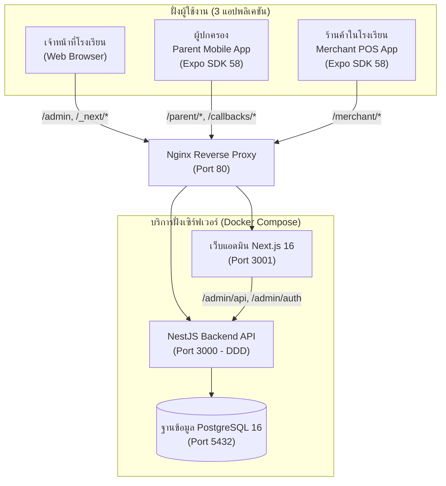

# 🏫 ภาพรวมโปรเจกต์ระบบคูปองดิจิทัลโรงเรียน (School Coupon System)

**School Coupon System** เป็นระบบบริหารจัดการคูปองดิจิทัลผ่านบัตร RFID สำหรับโรงเรียน ครอบคลุมตั้งแต่การจัดการบัญชีและบัตรนักเรียนโดยเจ้าหน้าที่, การเติมเงินและควบคุมวงเงินโดยผู้ปกครอง, การชำระเงินที่ร้านค้าทั้งแบบ Online และ Offline, การยกเลิกบิล ไปจนถึงการสรุปยอดโอนเงินให้ร้านค้าแบบ **T+1**

---

## 1. สถาปัตยกรรมระบบ (System Architecture)

ระบบทำงานผ่าน Docker Compose ([docker-compose.yml](file:///D:/School-Coupon/docker-compose.yml)) โดยมี **Nginx Reverse Proxy (Port 80)** เป็นจุดรับคำขอเดียว (Single Entry Point) เพื่อกระจายทราฟฟิกไปยัง Web Admin และ Backend API:



---

## 2. โครงสร้างโมดูลฝั่ง Backend (Domain-Driven Design)

Backend พัฒนาด้วย **NestJS 11 + TypeScript** แยกตาม Bounded Contexts ใน `src/modules/` ออกเป็น 4 โมดูลหลัก:

1. **`student-account` (บัญชีนักเรียน & บัตร RFID):**
   - ออกบัตรใหม่/อายัด/ปลดอายัดบัตร, คืนเงินเมื่อนักเรียนลาออก
   - เติมเงินผ่าน QR PromptPay (Sandbox / Omise) และรับ Webhook Callback
   - ตั้งค่าและตรวจสอบวงเงินใช้จ่ายรายวัน (`current_daily_limit` / `next_daily_limit`)
2. **`payments` (การชำระเงินร้านค้า):**
   - รับชำระเงินแบบ **Online** และ **Offline** ผ่านบัตร RFID
   - ซิงก์รายการออฟไลน์ขึ้นเซิร์ฟเวอร์ (`POST /merchant/payments/sync`)
   - ยกเลิกรายการขายภายในวันเดียวกัน (**Void**)
3. **`merchant-settlement` (สรุปยอดและโอนเงินร้านค้า):**
   - งานอัตโนมัติ (Cron) สรุปยอดขายประจำวันตอนเที่ยงคืน
   - หักค่าธรรมเนียมโรงเรียน (3%) และให้เจ้าหน้าที่อนุมัติโอนเงินรอบ **T+1**
4. **`school-configuration` (การตั้งค่าโรงเรียนและสิทธิ์):**
   - จัดการค่าตั้งต้นระดับโรงเรียน, สิทธิ์เจ้าหน้าที่ (OIDC) และบทบาทผู้ใช้งาน

---

## 3. เทคโนโลยีที่ใช้ (Tech Stack)

| ส่วนประกอบ | เทคโนโลยี | พอร์ต / ตำแหน่ง | หน้าที่หลัก |
|---|---|---|---|
| **Reverse Proxy** | Nginx (`nginx:alpine`) | Port `80` (`nginx/nginx.conf`) | จัดเส้นทาง HTTP และ Same-Origin Cookie Session |
| **Backend API** | NestJS 11, TypeScript, Express | Port `3000` (`src/`) | API หลัก, Business Rules, Ledger และ Cron Jobs |
| **Database** | PostgreSQL 16 (`pg`) | Port `5432` (`db/`) | เก็บข้อมูลนักเรียน, บัตร RFID, ธุรกรรม, Settlement |
| **Web Admin** | Next.js 16, React 19 | Port `3001` (`apps/admin`) | หน้าเว็บจัดการสำหรับเจ้าหน้าที่การเงินโรงเรียน |
| **Parent App** | React Native, Expo SDK 58 | Port `8081` (`apps/parent-mobile`) | แอปผู้ปกครอง: ดูยอด, เติมเงิน QR, ตั้งวงเงิน, อายัดบัตร |
| **Merchant POS** | React Native, Expo SDK 58 | Port `8082` (`apps/merchant-mobile`) | แอปร้านค้า: คิดเงิน Online/Offline, ซิงก์, Void บิล |
| **Testing** | Jest, Supertest, Embedded Postgres | `npm test` (`test/`, `tests/`) | ทดสอบ Unit, Integration, E2E (43 suites / 230 tests) |

---

## 4. ฟีเจอร์หลักและกติกาทางธุรกิจ (UC-01 ถึง UC-08)

| Use Case | ผู้ใช้งาน | สรุปการทำงาน & Business Rules (กติกาสำคัญ) | Endpoint หลัก |
|---|---|---|---|
| **UC-01** | เจ้าหน้าที่ | **ออกบัตรใหม่แทนบัตรหาย/ชำรุด:** อายัดบัตรเดิมและโอนยอดเงินคงเหลือไปบัตรใหม่ทันที | `POST /admin/cards/reissue` |
| **UC-02** | เจ้าหน้าที่ | **ระงับบัตร & คืนเงินนักเรียนลาออก:** อายัด/ปลดอายัดบัตร และคืนเงินคงเหลือทั้งหมด | `PATCH /admin/cards/:id/freeze`<br>`POST /admin/students/:id/refund` |
| **UC-03** | ผู้ปกครอง | **เติมเงินเข้ากระเป๋า (QR PromptPay):** เติมขั้นต่ำ `50` – สูงสุด `2,000` บ./ครั้ง (ยอดสะสมในบัตรไม่เกิน `5,000` บ.) | `POST /parent/wallet/topup`<br>`POST /callbacks/payment-gateway/topup` |
| **UC-04** | ผู้ปกครอง | **ตั้งวงเงินใช้จ่ายต่อวัน:** ปรับวงเงินรายวัน มีผลบังคับใช้วันถัดไปเวลา `00:00:00` น. | `PATCH /parent/students/:id/daily-limit` |
| **UC-05** | ร้านค้า POS | **คิดเงิน Online & Offline:**<br>• Online: เช็กยอดเงินคงเหลือ + วงเงินรายวัน<br>• Offline: รับได้สูงสุด `100` บ./รายการ, ยอดติดลบได้ถึง `-500` บ. เมื่อซิงก์ชนกัน, ล็อกเครื่องหากออฟไลน์เกิน `12` ชม. | `POST /merchant/payments`<br>`POST /merchant/payments/sync` |
| **UC-06** | ร้านค้า POS | **ยกเลิกบิล (Void):** ยกเลิกและคืนเงินเข้าบัตรได้ภายในวันเดียวกัน (ก่อน `23:59:59` น.) โดยไม่ต้องแตะบัตรซ้ำ | `POST /merchant/payments/:id/void` |
| **UC-07** | ระบบ / เจ้าหน้าที่ | **สรุปยอด & โอนเงิน T+1:** Cron สรุปยอดเที่ยงคืน หักค่าธรรมเนียมโรงเรียน `3%` และอนุมัติโอนเงินให้ร้านค้า | `GET /admin/settlements`<br>`POST /admin/settlements/:id/approve` |
| **UC-08** | เจ้าหน้าที่ | **ความปลอดภัย & เซสชัน:** ล็อกอินผ่าน OpenID Connect (OIDC) ตรวจสอบ Claim เจ้าหน้าที่ + HTTP-only Cookie | `GET /admin/auth/oidc/start`<br>`GET /admin/auth/session` |

---

## 5. ข้อมูลทดสอบเริ่มต้น (Seed Data — บัตร RFID จริง 5 ใบ)

ในฐานข้อมูลมีข้อมูลนักเรียนชื่อไทยครบ 35 คน และร้านค้า `id = 1` (`M-001`) พร้อมบัตร RFID จริงสำหรับทดสอบ 5 ใบ:

| ID | รหัสนักเรียน | ชื่อ - นามสกุล | รหัสบัตร RFID | ยอดเงินเริ่มต้น | วงเงินรายวัน |
|---|---|---|---|---|---|
| 1 | `STD-1001` | สมชาย ใจดี | `E280F3020000000145A58295` | 150.00 บ. | 200.00 บ. |
| 2 | `STD-1002` | สมหญิง รักเรียน | `E280F3020000000145A58285` | 200.00 บ. | 200.00 บ. |
| 3 | `STD-1003` | ต้นกล้า มีสุข | `E280F3020000000145A5828D` | 100.00 บ. | 150.00 บ. |
| 4 | `STD-1004` | น้ำใส สว่างจิต | `E280F3020000000145A58289` | 50.00 บ. | 100.00 บ. |
| 5 | `STD-1005` | ภูผา มั่นคง | `E280F3020000000145A58291` | 300.00 บ. | 250.00 บ. |

---

## 6. สถานะปัจจุบัน & แผนงานถัดไป

- **สิ่งที่เสร็จแล้ว:**
  - Backend + Web Admin เชื่อมข้อมูลจริงจาก PostgreSQL ครบ (รองรับ Pagination หน้าละ 10 รายการ)
  - ระบบเติมเงิน QR Sandbox + Webhook Callback ใช้งานได้จริง พร้อมต่อ Omise Test Mode
  - Mobile Apps อัปเดตเป็น Expo SDK 58 และตั้งค่า `baseUrl` เป็น `http://192.168.1.89`
  - Automated Tests (`npm test`) ผ่านครบ **43 suites / 230 tests**
- **แผนงานถัดไป (Backlog):**
  - ทดสอบ Use Cases บน Expo Go (`parent-mobile` & `merchant-mobile`) ให้ครบทุกขั้นตอน
  - รีดีไซน์ Mobile Apps ให้มีหน้า Login ผู้ปกครอง/ร้านค้า และดึงข้อมูลจริงจาก DB
  - เพิ่มฟีเจอร์แก้ไขข้อมูลโปรไฟล์นักเรียนบน Web Admin (`PATCH /admin/students/:id`) และโหมดสแกนบัตรเช็กยอดเงินแบบ Read-Only

---

## 7. คำสั่งเริ่มต้นใช้งาน (Quick Start)

```powershell
# 1. เปิด Backend, PostgreSQL, Web Admin และ Nginx
cd D:\School-Coupon
docker compose up -d

# 2. เปิดแอปผู้ปกครอง (Expo Go)
cd D:\School-Coupon\apps\parent-mobile
npx expo start

# 3. เปิดแอปร้านค้า POS (Expo Go)
cd D:\School-Coupon\apps\merchant-mobile
npx expo start --port 8082

# 4. รัน Automated Tests และ E2E Simulation
cd D:\School-Coupon
npm test
npm run simulate
```

- **Web Admin:** `http://localhost/dev-login` หรือ `http://localhost/admin`
- **API Health Check:** `http://localhost:3000/health`
