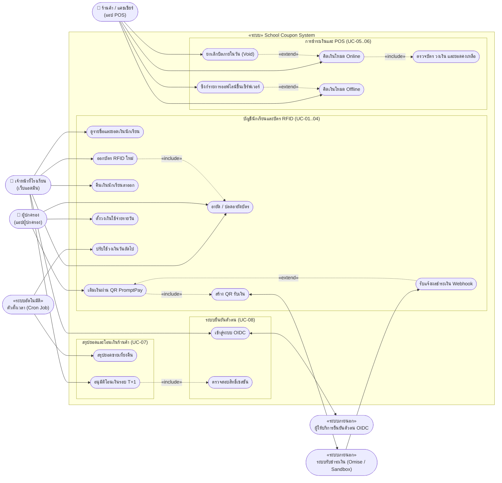

# 🎯 แผนภาพ UML Use Case Diagram — ระบบคูปองดิจิทัลโรงเรียน

แผนภาพแสดงผู้ใช้งานทั้งหมด (Actors) และขอบเขตการทำงานของระบบ **School Coupon System** พร้อมความสัมพันธ์แบบ UML (`«include»` และ `«extend»`)

---

## สรุปบทบาทผู้ใช้งานและระบบที่เกี่ยวข้อง (Actors)

| Actor | ช่องทางใช้งาน | หน้าที่และ Use Cases ที่เกี่ยวข้อง |
|---|---|---|
| **เจ้าหน้าที่โรงเรียน** | เว็บแอดมิน (Next.js) | เข้าสู่ระบบ OIDC (UC-08), ดูข้อมูลนักเรียน, ออกบัตรใหม่ (UC-01), อายัด/ปลดอายัด & คืนเงินลาออก (UC-02), อนุมัติโอนเงิน T+1 (UC-07) |
| **ผู้ปกครอง** | แอปผู้ปกครอง (Expo) | เติมเงิน QR PromptPay (UC-03), ตั้งวงเงินรายวัน (UC-04), อายัดบัตรหายชั่วคราว (UC-02) |
| **ร้านค้า / แคชเชียร์** | แอป POS (Expo) | คิดเงิน Online/Offline (UC-05), ซิงก์รายการออฟไลน์ (UC-05), ยกเลิกบิลภายในวัน (UC-06) |
| **ผู้ให้บริการ OIDC** | ระบบยืนยันตัวตนภายนอก | ตรวจสอบตัวตนและออกสิทธิ์เจ้าหน้าที่ (UC-08) |
| **ระบบรับชำระเงิน** | Omise / Sandbox API | สร้าง QR PromptPay และส่ง Webhook แจ้งผลเติมเงิน (UC-03) |
| **ตัวตั้งเวลาอัตโนมัติ** | Cron Job | สรุปยอดขายร้านค้าตอนเที่ยงคืน (UC-07) และปรับใช้วงเงินรายวันใหม่เวลา 00:00 น. (UC-04) |
